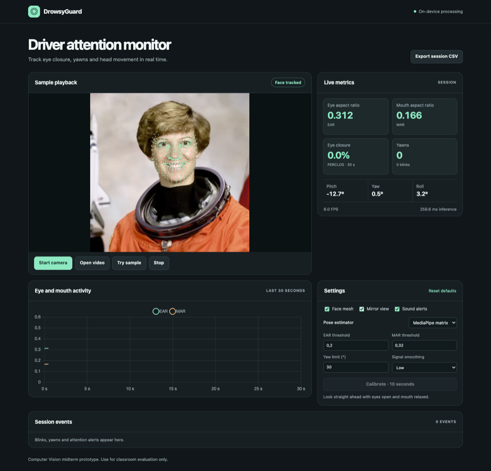

# DrowsyGuard

DrowsyGuard is a computer vision midterm project by Thiha Aung and Thin Lei Sandi. It uses MediaPipe Face Landmarker to track eye closure, yawns and head movement from a webcam or video file. Frames, landmarks and session logs stay in the browser. This is a classroom prototype for use while stationary.

[Open the demo](https://zaidenxthiha.github.io/drowsyguard/)

## Run locally

Install Node.js 22 and run:

```sh
npm ci
npm start
```

Open [http://127.0.0.1:4173](http://127.0.0.1:4173). The camera requires localhost or HTTPS. The model, JavaScript and WASM files are served by the same site. Local use after setup requires no external model requests.

1. Choose **Start camera**, **Open video** or **Try sample**. The sample is a short portrait clip for checking tracking and the overlay.
2. For your camera, face forward with your eyes open and mouth relaxed, then select **Calibrate · 10 seconds**. Calibration updates EAR and MAR thresholds and sets the neutral pose for the selected estimator.
3. View the signal chart and session events. Use **Export session CSV** to save the time series and detected events. The export remains available when the source stops or a clip ends.

The prolonged eye-closure alert clears on the first tracked open-eye frame. Sound plays once when an active alert begins. The PERCLOS card shows eye closure over the previous 30 seconds and can remain highlighted after the eyes reopen.

The look-away alert defaults to an 18° turn up, left, right, or diagonally upward held for one second. After calibration the angle is measured from your straight-ahead pose. The alert clears when you return within 15° at the default setting. You can change the trigger angle under **Settings → Look-away angle**. Sustained downward pitch uses the head-down rule.

The 468-point overlay uses the canonical face surface. The MediaPipe task also predicts 10 iris points. Settings include thresholds, smoothing, mirrored display, sound, and a choice between MediaPipe's pose matrix and an independent seven-point geometric fit.



## Verification and evaluation

```sh
npm test
npm run verify:web    # Chrome or Chromium and FFmpeg required
node tools/benchmark.mjs
```

Set `CHROME_PATH` if the browser is installed in a nonstandard location. The browser check covers the actual MediaPipe model, sample playback, upload, a simulated camera stream, calibration, CSV, and responsive layout.

For the dlib benchmark, install `dlib` and `opencv-python-headless` in a Python environment. Get the compressed 68-point predictor from [dlib](https://dlib.net/files/shape_predictor_68_face_landmarks.dat.bz2) and unpack it. See the [dlib example](https://dlib.net/face_landmark_detection.py.html) for the training data's usage terms.

```sh
python tools/benchmark_dlib.py --predictor /path/to/shape_predictor_68_face_landmarks.dat
```

The benchmark scripts record one timing and face-presence result per frame. Browser timings cover `detectForVideo`. Python timings cover grayscale conversion, face detection and the predictor when a face is found. Both exclude video decode, chart updates and rendering. The fixture videos are short controlled transformations of a still image plus a no-face control. Alert logic is exercised separately using scripted input signals. The fixtures support coverage and timing measurements. Driver-level precision and recall require annotated participant video.

## Deployment

`npm run build` writes the static demo to `dist/`. The included GitHub Actions workflow deploys that directory to GitHub Pages when the repository's Pages source is set to **GitHub Actions**.

## Credits

- [MediaPipe Face Landmarker](https://developers.google.com/edge/mediapipe/solutions/vision/face_landmarker) and [canonical face mesh](https://github.com/google-ai-edge/mediapipe/tree/master/mediapipe/modules/face_geometry/data), Google.
- [Chart.js](https://www.chartjs.org/), under the MIT license. See its bundled license.
- Portrait fixtures adapted from NASA's photo of Eileen Collins as distributed in [scikit-image's example data](https://scikit-image.org/docs/stable/api/skimage.data.html#skimage.data.astronaut). See [fixture details](test_videos/README.md).
